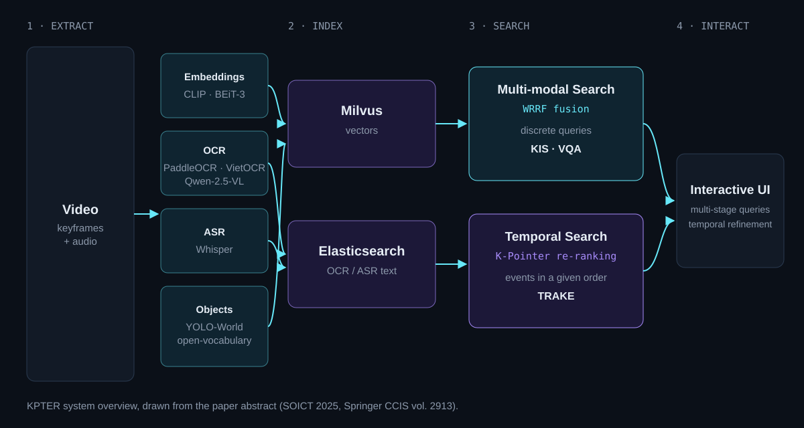
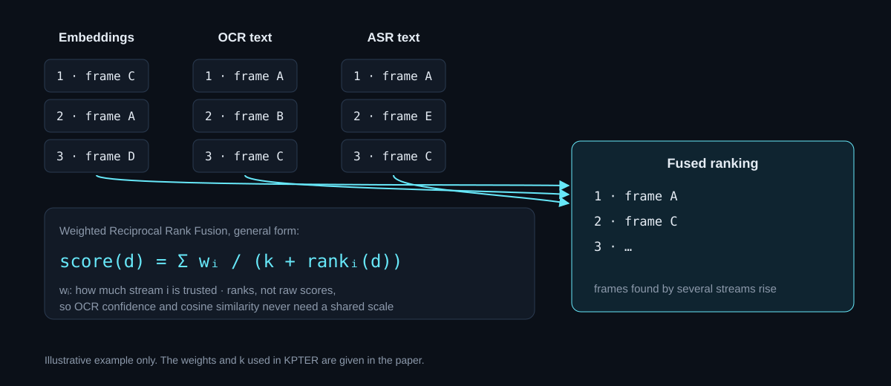
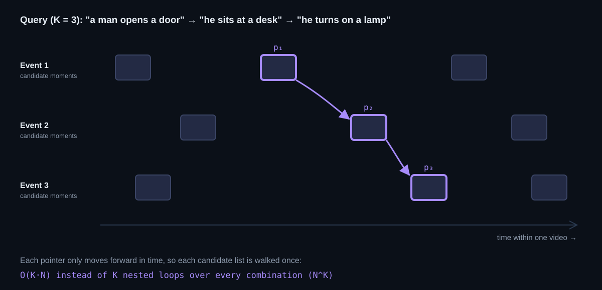

Our team, WATLERE, built **KPTER** for the Ho Chi Minh City AI Challenge 2025 and
published it at SOICT 2025 (Springer CCIS vol. 2913, pp. 304–318), where it received the
**Best Presentation Award**. This post explains the main ideas in plain terms. The paper
itself is [here](https://doi.org/10.1007/978-981-92-2587-3_24).

## The problem: three kinds of video search

The challenge asked teams to search a large video collection in three ways:

- **Known-item Search (KIS):** find the one moment that matches a description.
- **Visual Question Answering (VQA):** find the moment, then answer a question about it.
- **Temporal Retrieval and Alignment of Key Events (TRAKE):** new this year. The query
  describes *several* events, and the answer must contain them **in that order**.

The first two are "find one thing" problems. TRAKE is different: a frame that matches
event 2 is useless if it comes before the frame that matches event 1.

## The system at a glance

**1. Extract.** Every video is turned into several searchable signals:

- semantic embeddings from **CLIP** and **BEiT-3**, so text queries can match images;
- **OCR** (PaddleOCR, VietOCR, Qwen-2.5-VL) for text that appears on screen;
- **ASR** (Whisper) for what is said;
- open-vocabulary object detection (**YOLO-World**) for what is in the frame.

**2. Index.** Vectors go into **Milvus**; OCR and ASR text go into **Elasticsearch**.

**3. Search.** Two layers sit on top. The *Multi-modal Search* layer answers KIS and VQA,
and the *Temporal Search* layer answers TRAKE.

**4. Interact.** A user interface built for competition use lets a person build a query in
several steps and fine-tune the time window by hand.

## Fusing rankings, not scores (WRRF)

Each signal returns its own ranked list, and their scores do not share a scale: an OCR
confidence and a cosine similarity mean different things. So the Multi-modal Search layer
combines the lists with **Weighted Reciprocal Rank Fusion (WRRF)**, which looks only at
*positions*.

In its general form, each list adds `wᵢ / (k + rank)` to a frame's score. Ranks have no
scale, so the mismatch disappears. The weight `wᵢ` keeps what plain rank fusion throws
away: some signals are more reliable than others. A frame that several streams agree on
rises to the top, even if no single stream ranked it first.

## K-Pointer: checking event order in linear time

For TRAKE, each event in the query first gets its own list of candidate moments. A valid
answer picks one moment per event, all in the same video, in increasing time.

The obvious way is to try every combination: one loop per event, K nested loops in total.
With N candidates per event that is about NK checks, which explodes as queries
get longer.

**K-Pointer** keeps one pointer per event instead. Because the answer has to move forward
in time, a pointer never needs to step back, so each candidate list is walked once. The
cost becomes **O(KN)**, and the module can validate and rank whole sequences fast enough
for live use. (This is the idea in simplified form; the paper gives the exact procedure
and scoring.)

## Results

- **Top 12 of 80+ teams** at AI Challenge HCMC 2025, with a preliminary score of
  **82/88**.
- **Best Presentation Award** at SOICT 2025.

## Takeaways

- When signals do not share a scale, fuse their **rankings**, and weight the signals you
  trust more.
- Ordering constraints are an opportunity, not only a burden: "time only moves forward"
  is exactly what turns a combinatorial search into a linear scan.

---

*Duc Anh Khoa Dinh, Duc-Tai Dinh, Le Hoang Trung Nguyen, Thanh Nhan Nguyen (equal
contribution). KPTER: K-Pointer for Temporal Event Retrieval. SOICT 2025, Springer CCIS
vol. 2913, pp. 304–318.
[doi:10.1007/978-981-92-2587-3_24](https://doi.org/10.1007/978-981-92-2587-3_24)*
